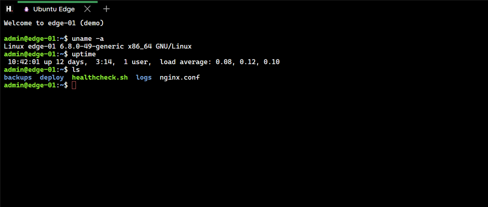
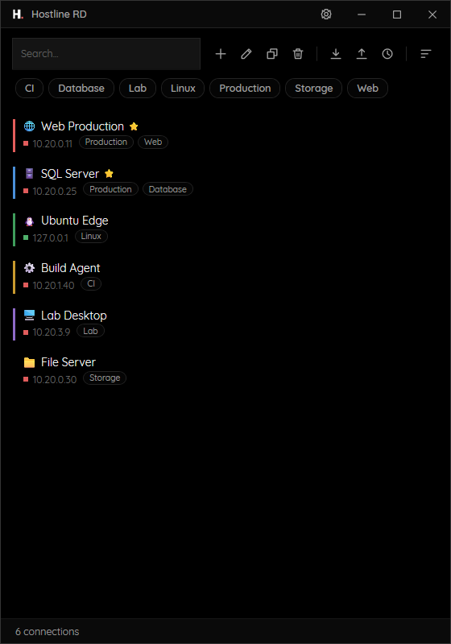
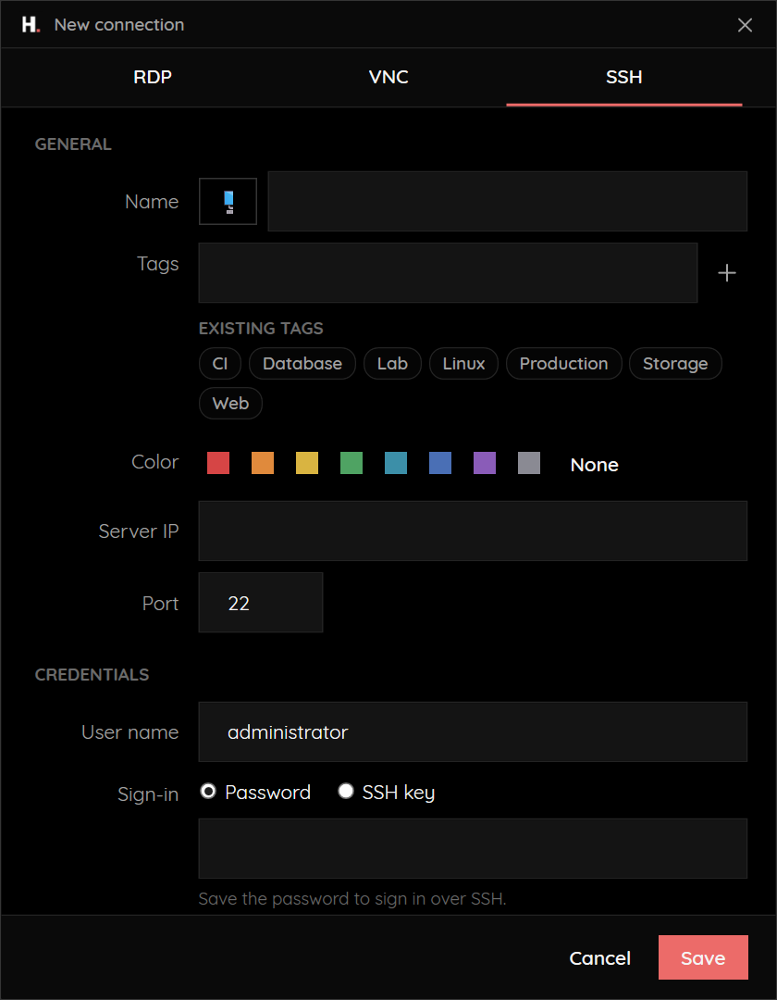

<p align="center">
  
</p>

<h1 align="center">Hostline RD</h1>

<p align="center">
  <b>RDP, VNC and SSH in one tabbed window.</b><br>
  A fast, native remote connection manager for Windows.
</p>

<p align="center">
  <a href="https://github.com/blnahmt/hostline/releases/latest"><b>Download for Windows</b></a> ·
  <a href="https://bilenahmet.com/hostline/">Website</a> ·
  <a href="https://github.com/blnahmt/hostline/issues">Report an issue</a>
</p>

<p align="center">
  
</p>

## Why Hostline RD

- **Native, not a browser in disguise.** Built with .NET 10 and WPF. RDP sessions use Microsoft's own Remote Desktop ActiveX control (the same engine as `mstsc`), so display quality, DPI scaling and clipboard behave like the built-in client.
- **Everything in tabs.** RDP, VNC and SSH sessions live side by side. Drag a tab out into its own window, go full screen, or span all monitors.
- **Your data stays on your machine.** No account, no cloud, no telemetry. Saved passwords are encrypted with Windows DPAPI for your Windows user.

## Features

**Sessions**
- RDP with automatic reconnect on network drops, RD Gateway, drive / printer / clipboard / camera redirection, multi-monitor full screen
- VNC with password authentication and two-way clipboard
- SSH terminal in a tab (xterm compatible: colours, `vim`, `htop`, copy and paste), signing in with a password or a private key, and host key verification on first use

**Organize**
- Tags, favorites, colour strips and instant search
- Reachability indicator for every server
- Connection history with durations
- Quick connect launcher on a global hotkey, and a command palette (`Ctrl+K`)

**Move and protect your list**
- Import `.rdp` and `.json` files
- Export with optional encryption (AES-256-GCM with your passphrase; passwords are only included when encrypted)

**Make it yours**
- Light and dark themes, colour palettes, square and minimal UI
- English and Turkish interface
- Automatic updates from GitHub Releases

<p align="center">
  
  &nbsp;
  
</p>

## Install

1. Download `HostlineRD_<version>_x64-setup.exe` from the [latest release](https://github.com/blnahmt/hostline/releases/latest).
2. Run it. No administrator rights are needed; it installs for the current user.

**Requirements**
- Windows 10 or 11, x64
- Nothing else to install: the .NET runtime is included in the installer
- Microsoft Edge WebView2 Runtime (built into Windows 11; only needed for SSH tabs)

The installer is not code-signed yet, so SmartScreen may ask you to confirm.

## Privacy

Connections, settings and history are stored in `%AppData%\HostlineRD`. The app only talks to the servers you connect to, checks whether they are reachable, and downloads `latest.json` from GitHub to look for updates (you can turn this off in Settings).

## Build from source

Prerequisites: [.NET 10 SDK](https://dotnet.microsoft.com/download/dotnet/10.0) and Windows.

```powershell
git clone https://github.com/blnahmt/hostline.git
cd hostline
dotnet build RdpManager.sln -c Debug
dotnet run --project src/RdpManager
```

The RDP interop assemblies are committed under `lib/`. To regenerate them you need `AxImp.exe` from the .NET Framework 4.8 SDK: `pwsh tools/Generate-Interop.ps1`.

Release builds and the installer are produced by `tools/Release.ps1` (needs [Inno Setup 6](https://jrsoftware.org/isinfo.php)). Developer notes (in Turkish) are in [docs/DEVELOPMENT.md](docs/DEVELOPMENT.md).

## Project structure

```text
hostline/
├── src/
│   ├── RdpManager/            the app (WPF, .NET 10)
│   │   ├── App.xaml.cs        startup, single instance, language, logging
│   │   ├── Rdp/               session hosts: RDP (ActiveX), VNC, SSH + host key store
│   │   ├── Services/          sessions, themes, tray, updates, reachability, hotkey
│   │   ├── Data/              SQLite storage, .rdp import, JSON import/export
│   │   ├── Security/          DPAPI for saved passwords, AES-GCM for exports
│   │   ├── Localization/      Loc + English dictionaries (Localization/en/*.tsv)
│   │   ├── Terminal/          xterm.js page used by SSH tabs
│   │   ├── Views/, ViewModels/, Models/
│   │   └── Resources/, Themes/  styles, icons, fonts, emoji
│   └── RdpManager.Tests/      xUnit tests
├── lib/                       RDP interop assemblies (generated from mstscax.dll)
├── tools/                     Release.ps1, installer.iss, Generate-Interop.ps1
└── docs/DEVELOPMENT.md        architecture notes and known pitfalls (Turkish)
```

## Contributing

Bug reports, ideas and pull requests are welcome. Please read [CONTRIBUTING.md](CONTRIBUTING.md) first; pull requests need a one-time [CLA](CLA.md) signature.

## Built with

| Component | Purpose | License |
|---|---|---|
| Microsoft Remote Desktop ActiveX (`mstscax.dll`) | RDP sessions | Part of Windows |
| [SSH.NET](https://github.com/sshnet/SSH.NET) | SSH connections | MIT |
| [xterm.js](https://github.com/xtermjs/xterm.js) + Microsoft Edge WebView2 | Terminal | MIT / Microsoft |
| [MarcusW.VncClient](https://github.com/karbonbaron/MarcusW.VncClient) | VNC sessions | MIT |
| [Dragablz](https://github.com/ButchersBoy/Dragablz) | Tear-off tabs | MIT |
| [Quicksand](https://fonts.google.com/specimen/Quicksand) | UI font | SIL OFL 1.1 |
| [Microsoft Fluent Emoji](https://github.com/microsoft/fluentui-emoji) | Connection icons | MIT |

## License

Hostline RD is **source-available** under the [PolyForm Strict License 1.0.0](LICENSE): free for noncommercial use, with one additional permission to modify the code to prepare contributions to this repository. Redistribution and modified versions are not allowed, so there is one official release. Contributions are accepted under the [CLA](CLA.md).

The names "Hostline" and "Hostline RD" and the logo are not licensed for other uses. Third-party components keep their own licenses (see [Built with](#built-with)).
